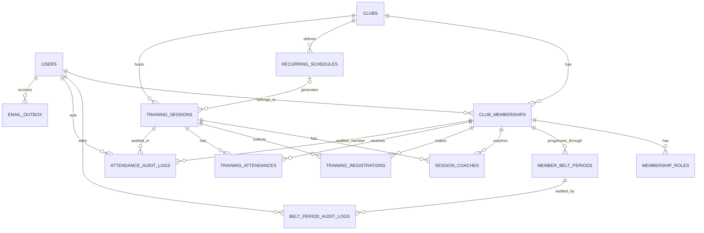

# Specifikacija aplikacije za evidenciju BJJ treninga

**Verzija:** 1.1 (MVP, konsolidirana specifikacija za implementaciju)  
**Datum:** 16. listopada 2026.  
**Status:** Zahtjevi za MVP potvrđeni; dodatna pravila pripisana kao implementacijske konvencije  
**Jezik sučelja:** hrvatski  
**Vremenska zona kluba:** `Europe/Zagreb`

## 1. Cilj, korisnici i opseg

Aplikacija omogućuje članovima BD Samobora prijavu na trening, a trenerima evidenciju stvarnih dolazaka. Sustav automatski vodi statistiku i šalje e-mail obavijesti relevantnim članovima.

Početni opseg: **1 klub, oko 20 članova i 3 trenera, najmanje godinu dana korištenja**. Samo jedna grupa, bez maksimalnog broja mjesta i bez paralelnih termina treninga. Treninzi su **utorkom i četvrtkom 18:30–20:00**, uz mogućnost iznimki i dodatnih treninga. Jedan trening mogu voditi dva ili više trenera.

U MVP ulazi:
- registracija putem pozivnica i autentikacija;
- uloge član / trener / administrator; više uloga po osobi;
- profil člana, stanje članstva, trenutačni pojas, datum dodjele i povijest pojaseva;
- automatski broj odrađenih treninga u trenutačnom i svakom prethodnom pojasu;
- tjedni raspored i jednokratne iznimke;
- prijava/otkazivanje prijave na trening;
- prozivka i evidencija stvarne prisutnosti;
- naknadne ispravke i povijesni unos;
- detaljna revizijska povijest evidencije;
- e-mail obavijesti i podsjetnici;
- statistika, izvještaji i CSV izvoz;
- responzivno web sučelje.

Izvan MVP-a: članarine, **crtice na pojasu**, više klubova, više grupa, liste čekanja, native iOS/Android aplikacije, javni poredak, broj sati treninga te objave/videozapisi/komentari (predloženi za v2, vidi §19).

## 2. Uloge i ovlasti

### 2.1 Uloge
- **MEMBER**: vidi svoj profil, buduće treninge, vlastite prijave i statistiku; samostalno se prijavljuje i otkazuje dok prisutnost nije evidentirana.
- **TRAINER**: sve što može MEMBER ako ima i tu ulogu; poziva članove; uređuje raspored, otkazuje termine, evidentira dolaske, ispravlja evidenciju, unosi povijest, evidentira i ispravlja promocije pojaseva, vidi izvještaje i audit.
- **ADMIN**: upravlja računima, ulogama i aktivnošću članstva; ima i sve operativne ovlasti trenera. Može biti MEMBER istovremeno.

Uloge su aditivne i neovisne. **Samo ADMIN dodjeljuje ili oduzima uloge TRAINER/ADMIN**. TRAINER može pozvati novog člana samo s ulogom MEMBER. ADMIN može pozvati i trenera. Spriječiti uklanjanje zadnjeg aktivnog administratora.

### 2.2 Matrica pristupa

| Radnja | MEMBER | TRAINER | ADMIN |
|---|:---:|:---:|:---:|
| Pregled rasporeda | Da | Da | Da |
| Prijava/otkazivanje vlastite prijave | Da | Ako je član | Ako je član |
| Pregled vlastite statistike i povijesti pojaseva | Da | Da | Da |
| Pregled tuđih pojaseva i statistike po pojasu | Ne | Da | Da |
| Evidentiranje i ispravljanje promocija pojaseva | Ne | Da | Da |
| Pozivanje novih članova | Ne | Da | Da |
| Kreiranje/izmjena/otkazivanje treninga | Ne | Da | Da |
| Pregled popisa prijavljenih | Ne* | Da | Da |
| Evidencija dolazaka, masovno označavanje odsutnih | Ne | Da | Da |
| Povijesni unos i ispravke | Ne | Da | Da |
| Pregled statistike drugih članova i CSV izvoz | Ne | Da | Da |
| Upravljanje ulogama i aktivacijom članstva | Ne | Ne | Da |
| Pregled audit loga prisutnosti | Ne | Da | Da |

*Za MVP član vidi broj prijavljenih samo ako to odlučimo prikazati, ali ne imena drugih članova. Polaznik nikada ne vidi tuđu pojedinačnu statistiku.

## 3. Korisnički račun i članstvo

### 3.1 Podaci profila
- ime — obvezno;
- prezime — obvezno;
- e-mail — obvezan, jedinstven (bez razlikovanja velikih i malih slova);
- broj telefona — neobvezan;
- trenutačni pojas — **izveden iz povijesti pojaseva**, jedan od `WHITE`, `BLUE`, `PURPLE`, `BROWN`, `BLACK`, ili `UNKNOWN` dok početni podatak nije unesen;
- datum dodjele trenutačnog pojasa — iz odgovarajućeg zapisa u povijesti (može biti nepoznat pri migraciji starih podataka);
- datum učlanjenja — obvezan, može se retroaktivno postaviti za stare članove;
- status članstva — `ACTIVE` / `INACTIVE`;
- uloge — najmanje jedna;
- datum kreiranja i posljednje izmjene.

Račun koji još nije aktivirao pozivnicu ima status `INVITED` (račun i status članstva nisu ista stvar). Neaktivan član se ne može prijaviti na buduće treninge, ali njegova povijest se čuva i prikazuje treneru.

### 3.2 Pozivanje i prijava
1. Trener ili administrator unosi e-mail te ime i prezime (administrator može zadati ulogu trenera).
2. Sustav šalje jednokratnu pozivnicu s tokenom i datumom isteka (predloženo 7 dana).
3. Korisnik otvara pozivnicu, postavlja lozinku, potvrđuje podatke i aktivira račun.
4. Korisnik se prijavljuje e-mailom i lozinkom.
5. Postoje odjava, zaboravljena lozinka i ponovno slanje pozivnice.
6. Sigurnost: lozinka se pohranjuje samo kao robustan password hash, pozivni/reset tokeni kao hash, bez otkrivanja postoji li e-mail adresa na ekranu za reset.

Predložena autentikacija: Spring Security sesija preko `HttpOnly`, `Secure`, `SameSite=Lax` kolačića, uz ispravnu CSRF zaštitu; isti origin za web UI i API. Nema potrebe za JWT-em i refresh tokenima u ovom MVP-u.

### 3.3 Pojasevi i povijest promocija (MVP v1.1)

U klubu se **ne koriste crtice**. Sustav ne sadržava ni polja, statuse, API-je niti korisničke ekrane za crtice. Definira se samo pet pojaseva: `WHITE`, `BLUE`, `PURPLE`, `BROWN`, `BLACK`.

Za svakog člana sustav čuva **redoslijed razdoblja pojaseva**, a ne samo jedno polje `belt` na profilu:
- naziv pojasa;
- datum stvarne dodjele (`awarded_on`);
- datum od kojeg se treninzi pripisuju tom pojasu (`effective_from_date`);
- tko je unio podatak te kada;
- opcionalnu napomenu i informaciju tko je dodijelio pojas, ako je poznata;
- povijest ispravaka datuma i pojasa (audit događaji).

**Korisničko pravilo:** na profilu se prikazuju *trenutačni pojas*, *datum dobivanja*, *treninzi u tom pojasu*, *ukupni treninzi* te tablica povijesti sa svim prethodnim pojasevima i njihovim brojem treninga. Svaki član vidi samo svoje podatke; trener i admin vide podatke svih članova. Nema javnog poretka pojaseva.

**Unos:** trener ili administrator bira člana, pojas i datum dodjele. Sustav pri novoj promociji provjerava kronološki redoslijed i sprječava preklapanja; može prikazati izračun buduće raspodjele treninga prije potvrde. Trener/admin može naknadno ispraviti krivo upisani datum/pojas, uz audit. Polaznik ne može sam mijenjati pojas.

**Razgraničenje treninga na dan promocije:** budući da klub standardno ima jedan trening po danu, u MVP-u vrijedi jasno zadano pravilo: *promocija na kraju treninga* ⇒ treninzi održani na datum dodjele pripadaju **prethodnom** pojasu, a novi pojas vrijedi za brojanje od **sljedećeg kalendarskog dana**. Ako je pojas dodijeljen prije treninga, trener prilikom unosa može odabrati „Vrijedi od dana dodjele”, pa `effective_from_date = awarded_on`. Datum dodjele prikazan korisniku uvijek ostaje stvarni `awarded_on` (ne prikazivati datum početka brojanja kao datum polaganja). To je MVP konvencija; više treninga prije/poslije promocije istog dana zahtijevalo bi preciznije vremenske granice u budućoj verziji.

**Početni unos i ranija povijest:** pri otvaranju profila moguće je upisati aktualni pojas, datum dodjele i poznate ranije pojaseve. Ako datum starog pojasa nije poznat, prikazati „datum nije evidentiran”; ne izmišljati datume. Za početni bijeli pojas bez poznatog datuma može se postaviti početak razdoblja na datum učlanjenja, ali bez tvrdnje da je tada održano polaganje. Ako raniji pojas u povijesti nije poznat, starije dolaske prikazati kao „neraspoređeni po pojasu”, umjesto da ih se pogrešno pripisuje trenutačnom pojasu.

**Integritet:** standardna promocija ide prema višem pojasu i ne može imati jednaki početak kao druga promocija istog člana. Pogrešan unos ispravlja se kontroliranom izmjenom s auditom, a ne fizičkim brisanjem povijesti bez traga. Posljednji važeći zapis određuje aktualni pojas. Audit promocija ne pokreće automatski obavijesti o prisutnosti; u v1.1 **ne uvodi se novi e-mail za dodjelu pojasa**.

## 4. Raspored i treninzi

### 4.1 Ponavljajuće pravilo
Osnovni raspored u vremenskoj zoni `Europe/Zagreb`:
- utorak 18:30–20:00;
- četvrtak 18:30–20:00.

Trener i administrator mogu mijenjati pravila za buduće termine, stvarati izvanredne termine, promijeniti vrijeme/termin pojedinačnog treninga i otkazati ga. Otkazivanje jednog treninga **ne briše** ponavljajuće pravilo.

### 4.2 Nastanak termina
- Backend unaprijed materijalizira termine iz pravila za narednih ~60 dana, ili primjenjuje ekvivalentan deterministički pristup.
- Za isto pravilo i originalni datum termina ne smije nastati duplikat (jedinstveni ključ).
- Izmijenjeni/otkazani pojedinačni termini ne smiju se ponovno stvoriti pri sljedećem generiranju.
- Za MVP nema preklapajućih aktivnih termina u klubu.
- Jedan termin može imati više trenera; bilo koji trener kluba može evidentirati prisutnost (dodijeljeni treneri su informacija, ne ograničenje pristupa).
- Povijesni termini unose se ručno i označavaju kao održani.

### 4.3 Status termina
- `SCHEDULED` – planiran;
- `CANCELLED` – otkazan;
- `HELD` – održan / završio, i dalje je dopuštena ispravka evidencije.

Vrijeme završetka automatski može označiti trening održanim ako nije otkazan; status `HELD` **nije zaključavanje evidencije**. Za ručni povijesni unos status može odmah biti `HELD`. Nije potreban poseban korak „zaključi trening”.

## 5. Prijava na trening

### 5.1 Polaznik
- Početni ekran prikazuje sljedeće treninge, s primarnim CTA „Prijavi se” ili „Otkaži prijavu”.
- Prijava je dopuštena aktivnom članu za planiran ili započet, ali neotkazan termin dok njegova prisutnost nije evidentirana; može i neposredno prije početka. U pravilu se prijavljuje na buduće treninge; za neprijavljenog polaznika na održanom terminu evidenciju unosi trener.
- Prijava ne znači dolazak.
- Član može otkazati prijavu **bilo kada dok za njega nema evidentiranog statusa `PRESENT` ili `ABSENT`**, čak i nakon početka termina. Nema dodatnog vremenskog roka.
- Nakon evidencije prisutnosti promjene radi trener.
- Ponovna prijava nakon otkazivanja moguća je dok nema evidentirane prisutnosti.
- U istoj sesiji ne postoje dvije aktivne prijave istog člana.
- Korisnik prima e-mail potvrdu prijave i otkazivanja prijave.

### 5.2 Trener
- Može dodati člana koji nije bio prijavljen i odmah ga označiti prisutnim.
- Ako je član otkazao prijavu, a ipak došao, trener ga može evidentirati kao prisutnog; izvor prijave/odjave ostaje dostupan u povijesti.
- Neaktivne članove ne dodavati na nove termine bez administrativne reaktivacije; povijesni unos za njihov raniji period dopušten.

## 6. Evidencija prisutnosti (ključna funkcija)

### 6.1 Stanja

**Registration:** `REGISTERED`, `CANCELLED` (uz timestamps i opcionalan izvor radnje).

**Attendance:** `PRESENT`, `ABSENT` ili **nepostojanje zapisa** (= `UNMARKED`, još nije odlučeno). To nisu ista polja/tablice.

| Registracija | Prisutnost | Značenje |
|---|---|---|
| REGISTERED | UNMARKED | Prijavio dolazak, čeka prozivku |
| REGISTERED | PRESENT | Prijavio se i došao |
| REGISTERED | ABSENT | Prijavio se i nije došao |
| CANCELLED | UNMARKED | Otkazao prijavu |
| CANCELLED | PRESENT | Otkazao, ali ipak došao; trener evidentirao |
| bez registracije | PRESENT | Došao bez prijave; trener dodao |
| bez registracije | ABSENT | Ručni unos izostanka; nije primaran MVP scenarij |

Trener mora moći ispraviti `PRESENT ↔ ABSENT`. Za iznimne slučajeve može i vratiti status na `UNMARKED`, uz audit događaj; time se ponovno omogućuje samostalno otkazivanje prijave, ako to drugi uvjeti dopuštaju.

### 6.2 Trenerov ekran
- Naslov, datum i vrijeme treninga, dodijeljeni treneri.
- Popis svih prijavljenih s jasnim prikazom `UNMARKED`, `PRESENT`, `ABSENT`.
- Broj prijavljenih, potvrđenih prisutnih, označenih odsutnih, nepotvrđenih.
- Za svaki redak brza radnja „Prisutan” / „Odsutan”; trenutačno stanje jasno označeno.
- Pretraga članova te dodavanje neprijavljenog člana.
- Gumb „Označi sve preostale odsutnima”, uz potvrdu radnje i prikaz broja obuhvaćenih članova.
- Automatsko spremanje bez glavnog gumba „Spremi”.
- Vizualne povratne informacije: `Spremanje`, `Spremljeno`, `Greška pri spremanju`.
- Kod mrežne greške **ne prikazivati promjenu kao uspješno spremljenu**; ponuditi ponovni pokušaj.

### 6.3 Masovno označavanje
Gumb `Označi sve preostale odsutnima` djeluje **samo na članove s `REGISTERED` i `UNMARKED`**. Ne smije promijeniti već označene `PRESENT` ili `ABSENT`, niti otkazane prijave. Za svakog člana nastaje zaseban audit zapis i zasebna e-mail notifikacija.

### 6.4 Istodobne izmjene
Dva trenera mogu imati otvoren isti trening. Backend mora spriječiti tihi gubitak izmjena:
- za evidenciju koristiti optimistično zaključavanje (`version` ili ekvivalent),
- pri konfliktu vratiti `409 CONFLICT` s trenutačnim stanjem,
- frontend osvježava sporni redak i dopušta treneru ponovno odlučiti.

Brze ponovljene identične akcije ne smiju stvarati nove, nepotrebne e-mailove (idempotentno ako se stanje stvarno nije promijenilo).

## 7. Revizijska povijest

Svaka stvarna promjena statusa `Attendance` bilježi:
- jedinstveni `audit_id`;
- `training_session_id`;
- `member_id`;
- `actor_user_id` – trener ili administrator koji je napravio promjenu;
- `previous_status` i `new_status` (uključujući `UNMARKED`);
- UTC timestamp promjene;
- izvor (`SINGLE`, `BULK`, `HISTORICAL_IMPORT`, `CORRECTION`);
- opcionalnu napomenu.

Audit je append-only (bez izmjene i brisanja redaka kroz uobičajeni UI). Trener/admin vidi povijest; polaznik vidi vlastitu konačnu evidenciju, bez nužnog prikaza podataka o trenerovoj aktivnosti. Za izmjene u prijavama preporučen je dodatni `RegistrationEvent` radi forenzičke jasnoće, no korisnički zahtjev za auditom obvezno se odnosi na prisutnost.

## 8. E-mail obavijesti

### 8.1 Vrste

| Tip | Primatelj | Okidač |
|---|---|---|
| Pozivnica | Novi korisnik | Trener/admin pozove člana |
| Potvrda prijave | Član | Uspješna nova prijava / ponovna prijava |
| Potvrda otkazivanja prijave | Član | Sam otkaže prijavu |
| Podsjetnik | Trenutno prijavljen član | 3 sata prije početka treninga |
| Otkazan trening | Prijavljeni članovi | Trener/admin otkaže termin |
| Promijenjen termin | Prijavljeni članovi | Trener/admin izmijeni vrijeme/datum |
| Evidentirana/ispravljena prisutnost | Pogođeni član | Svaka stvarna promjena prisutnosti, i pri masovnoj radnji |
| Reset lozinke | Korisnik | Zahtjev za reset |

### 8.2 Podsjetnik
- Šalje se **točno prema terminu `start_at - 3h`**, što za standardni početak u 18:30 znači 15:30 po vremenskoj zoni kluba.
- Šalje se samo članovima čija je prijava još uvijek `REGISTERED` u trenutku pripreme obavijesti.
- Ne šalje se za otkazan trening.
- Jedan podsjetnik po članu i terminu (`UNIQUE(type, member, session)` ili odgovarajući idempotency key).
- Ako se član prijavi nakon predviđenog vremena podsjetnika, retroaktivni podsjetnik se ne šalje; potvrda prijave se i dalje šalje.
- Ako se termin promijeni, obavijest o promjeni ide odmah; ponašanje već poslanog podsjetnika ne duplicirati u MVP-u.

### 8.3 Pouzdanost slanja
- Poslovna promjena i događaj za slanje upisuju se u jednoj DB transakciji (transactional outbox).
- Zasebni jednostavni pozadinski posao unutar iste aplikacije obrađuje outbox; periodično šalje e-mailove.
- `PENDING`, `SENT`, `FAILED` / retry, `attempt_count`, `next_attempt_at`, `last_error`.
- Kod privremene greške e-mail servisa ponoviti slanje s backoff strategijom.
- Na ekranu ne tvrditi da je e-mail dostavljen ako je samo stavljen u red čekanja.
- Ne slati e-mail ponovo na svaki frontend retry iste promjene.

**Posebno pravilo za povijesni unos:** Korisnik je tražio e-mail pri svakom trenerovom evidentiranju, pa to načelno uključuje i unos starijih dolazaka. Ako se odjednom unese puno starih treninga, to može stvoriti mnogo e-mailova. Preporučeno je prije većeg uvoza omogućiti administratoru posebno odobren način povijesnog unosa uz jasno definiranu politiku obavještavanja, umjesto implicitnog utišavanja obavijesti.

## 9. Statistika

### 9.1 Član vidi samo sebe
- ukupan broj odrađenih treninga (`PRESENT`);
- broj u tekućem mjesecu;
- broj zadnjih 7 i 30 dana;
- povijest treninga, datum i status;
- broj prijava bez dolaska (`REGISTERED` + `ABSENT`);
- trenutačni pojas i datum njegove dodjele;
- broj potvrđenih treninga u trenutačnom pojasu i u svakom prethodnom pojasu;
- povijest pojaseva (pojas, datum dodjele, razdoblje, treninzi unutar njega);
- postotak dolazaka u odnosu na **sve održane termine nakon datuma učlanjenja dok je član bio aktivan**, s točno naznačenim nazivnikom; alternativni postotak „dolazak po prijavi” prikazati odvojeno ako bude potreban.

Ne brojati otkazane treninge. Ako je član bio aktivan samo dio razdoblja, nazivnik obuhvaća termine za vrijeme aktivnog članstva; zbog tog zahtjeva preporučena je povijest aktivacije/deaktivacije članstva ili jasno definirano pojednostavljenje za MVP.

### 9.2 Trener i admin
- svi članovi s brojem dolazaka (ukupno, mjesec, 7/30 dana);
- rangiranje po broju `PRESENT`;
- broj i prosjek prisutnih po terminu/mjesecu;
- polaznici koji dugo nisu dolazili (npr. 14/30 dana);
- postotak nedolazaka nakon prijave;
- filter po razdoblju i polazniku;
- filtar po pojasu i broj treninga po pojedinom pojasu za svakog polaznika;
- CSV izvoz izvještaja (UTF-8 BOM za kompatibilnost s Excelom, odgovarajući separator i datumi).

Broje se **treninzi, a ne sati**. Jedan polaznik na jednom terminu može dobiti najviše jedan dolazak. Za ispravke se svi izračuni ažuriraju prema najnovijoj vrijednosti `Attendance`, a audit ostaje nepromijenjen.


### 9.3 Točno pravilo izračuna treninga po pojasu

`total_trainings(member) = COUNT(DISTINCT training_session_id)` samo za zapise `training_attendances.status = PRESENT` na **održanim** (`HELD`) i neotkazanim treninzima. Za vremensko razgraničenje koristi se **lokalni datum treninga u `Europe/Zagreb`**, a ne datum kada je trener unosio ili ispravljao evidenciju.

`trainings_in_belt(member, belt_period) = broj PRESENT dolazaka na održanim treninzima s lokalnim datumom >= effective_from_date tog razdoblja i < effective_from_date sljedećeg razdoblja`; za trenutačni pojas nema gornje granice. Ako povijest nije potpuna, prikazati neraspoređene dolaske zasebno. Vrijedi provjera: **zbroj treninga po svim pojasevima + neraspoređeni = ukupan broj treninga**.

Ne pohranjivati brojače kao zasebnu poslovnu istinu: računati ih SQL upitom ili projekcijom koja se ispravno osvježava nakon naknadnog `PRESENT/ABSENT` ispravka, promjene datuma treninga, unosa povijesnih dolazaka ili korekcije promocije. Jedan trening ne smije završiti u dva pojasa.

## 10. Model podataka

Predložene relacijske cjeline (nazivi su prijedlog za implementaciju):

| Tablica | Ključna polja i ograničenja |
|---|---|
| `clubs` | `id`, `name`, `timezone`; zasad jedan zapis |
| `users` | `id`, `first_name`, `last_name`, `email UNIQUE`, `phone`, `password_hash`, `account_status`, timestamps |
| `club_memberships` | `id`, `club_id`, `user_id`, `joined_on`, `status`, timestamps; `UNIQUE(club_id,user_id)`; **bez redundantnog `belt` polja** |
| `member_belt_periods` | `id`, `membership_id`, `belt`, `awarded_on DATE NULL`, `effective_from_date DATE NOT NULL`, `awarded_by_user_id NULL`, `note NULL`, `created_by_user_id`, `created_at`, `updated_at`, `version`; jedinstveno `(membership_id,effective_from_date)`; pojas se izvodi iz posljednjeg važećeg razdoblja |
| `belt_period_audit_logs` | `id`, `belt_period_id`, `membership_id`, `actor_user_id`, `action`, `old_values JSONB`, `new_values JSONB`, `occurred_at`; append-only |
| `membership_roles` | `membership_id`, `role`; `UNIQUE(membership_id,role)` |
| `invitations` | `id`, `club_id`, `email`, `token_hash`, `expires_at`, `accepted_at`, `inviter_id` |
| `recurring_schedules` | `id`, `club_id`, `weekday`, `start_time`, `end_time`, `valid_from`, `valid_to`, `enabled` |
| `training_sessions` | `id`, `club_id`, `schedule_id?`, `occurrence_date?`, `start_at`, `end_at`, `status`, `version`, `created_by`; jedinstvenost `(schedule_id,occurrence_date)` kad je pravilo prisutno |
| `session_coaches` | `session_id`, `membership_id`; zajednički PK |
| `training_registrations` | `id`, `session_id`, `membership_id`, `status`, `registered_at`, `cancelled_at`, `version`; `UNIQUE(session_id,membership_id)` |
| `registration_events` | `id`, `registration_id`, `event_type`, `actor_id`, `occurred_at` (preporučeno) |
| `training_attendances` | `id`, `session_id`, `membership_id`, `status`, `updated_by`, `updated_at`, `version`; `UNIQUE(session_id,membership_id)` |
| `attendance_audit_logs` | `id`, `session_id`, `membership_id`, `actor_id`, `old_status`, `new_status`, `action_source`, `occurred_at` |
| `email_outbox` | `id`, `event_type`, `recipient_user_id`, `session_id?`, `payload`, `status`, `attempt_count`, `next_attempt_at`, `sent_at`, `deduplication_key UNIQUE` |
| `membership_status_events` | `membership_id`, `old_status`, `new_status`, `effective_at`, `actor_id` – potrebno za točne povijesne postotke ako se statusi mijenjaju |

Datume/vremena događaja pohranjivati kao UTC trenutke (`TIMESTAMPTZ` ili ekvivalent), a prikazivati u `Europe/Zagreb`; datum učlanjenja kao `DATE`, dan u tjednu i sat ponavljanja kao lokalno vrijeme.

### 10.1 ER prikaz



**Važno:** `club_memberships` i `clubs` su minimalna priprema za eventualni drugi klub, ali MVP i API rade samo u kontekstu jednog kluba. Nema multi-tenant naplate, izolacije više klubova ili UI prebacivanja klubova.

### 10.2 Integritet i indeksi
- Strani ključevi moraju spriječiti bilježenje prisutnosti korisniku koji nije član tog kluba.
- `UNIQUE(session_id, membership_id)` i na prijavi i na prisutnosti.
- `CHECK` ili enums za status, validacija `end_at > start_at`.
- Indeksi na `training_sessions(start_at, status)`, `training_registrations(session_id,status)`, `training_attendances(membership_id,status)`, `attendance_audit_logs(membership_id,occurred_at)`, `member_belt_periods(membership_id,effective_from_date)` i na outbox status/termin slanja.
- Za povijest pojaseva zahtijeva se jedinstven efektivni datum unutar člana, striktni kronološki redoslijed i nepreklapanje razdoblja; validirati i u transakcijskoj servisnoj logici, uključujući konkurentne upise.
- Nema fizičkog brisanja povijesnih treninga i evidencija kroz UI; koristi se otkazivanje/soft-archive gdje je smisleno.

## 11. REST API – predloženi ugovor

Prefiks: `/api/v1`. Tijelo zahtjeva/odgovora: JSON, datumi ISO 8601. Svi endpointi zahtijevaju autentikaciju osim aktivacije pozivnice i resetiranja lozinke.

### 11.1 Auth i profil

| Metoda | Endpoint | Svrha |
|---|---|---|
| POST | `/auth/login` | Prijava i uspostava sesije |
| POST | `/auth/logout` | Odjava |
| GET | `/me` | Trenutni korisnik, uloge, članstvo |
| POST | `/auth/invitations/accept` | Aktivacija pozivnice i postavljanje lozinke |
| POST | `/auth/password-reset/request` | Zahtjev za reset |
| POST | `/auth/password-reset/confirm` | Potvrda reseta |
| PATCH | `/me/profile` | Vlastiti telefon i dopuštena osobna polja |

### 11.2 Članovi

| Metoda | Endpoint | Uloga / svrha |
|---|---|---|
| GET | `/members` | Trener/admin – popis i pretraga |
| POST | `/members/invitations` | Trener/admin – poziv (trener može samo MEMBER) |
| GET | `/members/{id}` | Trener/admin – profil |
| PATCH | `/members/{id}` | Admin – aktivnost, datum učlanjenja i osnovni podaci (**ne mijenja pojas izravno**) |
| PUT | `/members/{id}/roles` | Admin – dodjela uloga |
| GET | `/members/{id}/statistics` | Trener/admin – statistika člana |
| GET | `/me/statistics` | Član – vlastita statistika, uključujući broj treninga po pojasu |
| GET | `/me/belts` | Član – vlastita povijest pojaseva i njihova statistika |
| GET | `/members/{id}/belts` | Trener/admin – povijest i statistika pojaseva člana |
| POST | `/members/{id}/belts` | Trener/admin – nova promocija ili početni unos pojasa |
| PATCH | `/members/{id}/belts/{beltPeriodId}` | Trener/admin – ispravak pojasa/datuma s `expectedVersion` i auditom |
| GET | `/members/{id}/belts/audit` | Trener/admin – povijest ispravaka pojaseva |

### 11.3 Raspored

| Metoda | Endpoint | Svrha |
|---|---|---|
| GET | `/trainings?from=...&to=...` | Vidljivi termini u razdoblju |
| GET | `/trainings/{id}` | Detalji treninga |
| POST | `/trainings` | Trener/admin – izvanredni ili povijesni trening |
| PATCH | `/trainings/{id}` | Trener/admin – pomicanje/izmjena termina |
| POST | `/trainings/{id}/cancel` | Trener/admin – otkazivanje termina |
| GET | `/recurring-schedules` | Pravila rasporeda |
| POST | `/recurring-schedules` | Trener/admin – novo pravilo |
| PATCH | `/recurring-schedules/{id}` | Trener/admin – izmjene budućeg rasporeda |

### 11.4 Prijave i evidencija

| Metoda | Endpoint | Svrha |
|---|---|---|
| PUT | `/trainings/{id}/my-registration` | Prijava trenutnog člana; idempotentno |
| DELETE | `/trainings/{id}/my-registration` | Otkaz prijave ako nije evidentirana prisutnost |
| GET | `/trainings/{id}/roster` | Trener/admin – prijavljeni i stanja |
| PUT | `/trainings/{id}/attendance/{membershipId}` | Trener/admin – postavi `PRESENT` ili `ABSENT` |
| DELETE | `/trainings/{id}/attendance/{membershipId}` | Trener/admin – povratak na `UNMARKED`, s auditom |
| POST | `/trainings/{id}/attendance/mark-unconfirmed-absent` | Trener/admin – označi sve prijavljene nepotvrđene odsutnima |
| GET | `/trainings/{id}/attendance/audit` | Trener/admin – audit treninga |

### 11.5 Izvještaji

| Metoda | Endpoint | Svrha |
|---|---|---|
| GET | `/reports/attendance?from=...&to=...` | Trener/admin – statistika |
| GET | `/reports/attendance.csv?from=...&to=...` | Trener/admin – izvoz |
| GET | `/reports/inactive-members?days=14` | Trener/admin – dulje neaktivni po dolascima |

### 11.6 Primjer unosa promocije

`POST /api/v1/members/{id}/belts` (trener/admin):

```json
{
  "belt": "BLUE",
  "awardedOn": "2026-10-15",
  "promotionTiming": "AFTER_TRAINING",
  "note": "Promocija nakon redovnog treninga"
}
```

Odgovor `201 Created` uključuje `awardedOn`, izračunani `effectiveFromDate` (u primjeru `2026-10-16`), ažurirani `currentBelt` i broj treninga po pojasu. Za `BEFORE_TRAINING` početak brojanja je datum dodjele. Drugi unos za isti efektivni datum vraća `409`. Korekcija datuma ili pojasa dopuštena je uz audit i optimističko zaključavanje; javno dostupan `DELETE` za promociju nije dio MVP-a.

### 11.7 Primjeri razmjene

`PUT /api/v1/trainings/{id}/attendance/{membershipId}`

```json
{
  "status": "PRESENT",
  "expectedVersion": 2,
  "note": "Dolazak potvrđen na prozivci"
}
```

Uspješan odgovor `200 OK`:

```json
{
  "memberId": "membership-123",
  "trainingId": "training-456",
  "status": "PRESENT",
  "version": 3,
  "updatedAt": "2026-10-20T16:32:00Z",
  "notificationStatus": "QUEUED"
}
```

Bulk zahtjev je idempotentan u smislu da ponovni poziv ne mijenja već obrađene zapise. Odgovor vraća broj ažuriranih članova, a svaki član ima zaseban audit/notification event.

### 11.8 HTTP pogreške
- `400` – neispravan zahtjev;
- `401` – nije prijavljen;
- `403` – nema ovlast;
- `404` – nepostojeći ili nedostupni resurs;
- `409` – sukob stanja (npr. već evidentirana prisutnost, konflikt istodobnih izmjena, dupli termin);
- `422` – poslovno pravilo onemogućuje radnju;
- `429` – previše pokušaja prijave/resetiranja;
- `500` – neočekivana pogreška.

Sve pogreške u dosljednom formatu `application/problem+json` uz `type`, `title`, `status`, `detail`, `instance`, `errorCode`.

## 12. Sučelja

### 12.1 Član
- Prijava/aktivacija/lozinka;
- početna – sljedeći trening (glavni gumb), drugi sljedeći trening, status prijava;
- kalendar budućih i prošlih treninga;
- „Moja statistika” – glavni brojači, povijest i treninzi po pojasu;
- „Moj profil” – trenutačni pojas, datum dodjele i povijest pojaseva (bez crtica).

### 12.2 Trener
- Danas / sljedeći trening – prikaz prijavljenih;
- prozivka – krupni gumbi i statusi, dodavanje člana, masovno označavanje odsutnih;
- upravljanje terminima – kreiranje, pomicanje, otkazivanje, povijesni unos;
- članovi – imenik, pozivnice, statistika i administriranje promocija pojaseva;
- izvještaji – filteri, izvoz;
- revizijska povijest za evidenciju.

### 12.3 Administrator
Sve trenerove stranice, plus upravljanje ulogama i statusima članstva. Jedan korisnik s više uloga ima jedan račun i jedinstvenu navigaciju, bez duple registracije.

### 12.4 Mobile-first UX
- Prijava na trening najviše 1–2 dodira od početnog ekrana.
- Trenerova prozivka mora biti praktična na uskom ekranu i s dvadesetak članova.
- Velike dodirne površine, jasni prikazi spremanja i grešaka, čitljiv kontrast.
- Bez zahtjeva za instalaciju aplikacije.

## 13. Tehnička arhitektura

### 13.1 Preporučeni stack
- **Backend**: Java 21 LTS, Spring Boot 4.1.x, Spring MVC, Spring Security, Bean Validation, Spring Data JPA/Hibernate.
- **Frontend**: React, TypeScript, Vite, React Router, TanStack Query; za stil npr. Tailwind CSS.
- **DB**: PostgreSQL.
- **Migracije**: Flyway, bez automatskog kreiranja produkcijske sheme putem Hibernate `update`.
- **Testovi**: JUnit 5, AssertJ/Mockito, Testcontainers PostgreSQL, Playwright.
- **E-mail**: transakcijski SMTP/API provider, predložak s hrvatskim tekstovima.
- **Deployment**: Docker Compose ili ekvivalent; aplikacija + PostgreSQL + statički frontend iza reverse proxyja i HTTPS-a.
- **Dokumentacija API-ja**: OpenAPI/Swagger, verzionirani endpointi `/api/v1`.
- **Observability**: strukturirani logovi, Actuator health, osnovni pokazatelji pogrešaka i outbox reda.

Nema potrebe za mikroservisima, Kafkom, Redisom, Kubernetesom ni kompleksnim event busom. Poslove obavijesti i generiranje termina može odraditi ista backend aplikacija raspoređenim zadacima uz DB zaključavanje gdje treba.

### 13.2 Moduli (modularni monolit)

```text
backend/
  auth/
  members/
  belts/
  scheduling/
  registrations/
  attendance/
  reporting/
  notifications/
  shared/
frontend/
  src/features/auth/
  src/features/trainings/
  src/features/attendance/
  src/features/members/
  src/features/belts/
  src/features/statistics/
```

Odvojiti API DTO-ove od JPA entiteta; koristiti servisni sloj i transakcijske granice. Ne stavljati poslovnu logiku u kontrolere. `AttendanceService` je autoritet za upis prisutnosti i audit; modul notifikacija reagira na trajno spremljene outbox zapise.

## 14. Sigurnost, privatnost i operativni zahtjevi

- HTTPS obvezan; `Secure`, `HttpOnly`, `SameSite` cookies + CSRF zaštita.
- Ovlasti provjeravati na backendu za svaki endpoint; član ne može mijenjati tuđe ID-jeve ili čitati tuđe izvještaje.
- Rate limit za prijavu, reset lozinke, pozivnice.
- Lozinke nikad ne stavljati u logove ili e-mailove.
- Čuvati minimalne podatke; objaviti obavijest o obradi osobnih podataka, definirati rok čuvanja i procedure pristupa/ispravka/brisanja prema primjenjivom pravu.
- Posebno zaštititi audit i pristup brojevima telefona.
- Dnevni backup baze, barem jedan provjeren test obnove; definirati zadržavanje backupa (prijedlog 30 dana).
- Minimalna dostupnost: uobičajen hosting s jednom instancom; nema potrebe za HA klasterom.
- Stranice za prijavu/prozivku trebaju raditi brzo na mobilnoj vezi (cilj: većina API akcija ispod 1 s bez vanjskog slanja e-maila u HTTP zahtjevu).
- E-mail slanje nikad ne blokira spremanje evidencije.
- Sigurna migracija podataka i odvojene konfiguracije dev/staging/production.

## 15. Rubni slučajevi i prihvatni kriteriji

| ID | Scenarij | Očekivani rezultat |
|---|---|---|
| AC-01 | Trener pozove polaznika | Korisnik dobiva jednokratnu pozivnicu i aktivira račun |
| AC-02 | Trener ima i ulogu MEMBER | Može se prijaviti na trening i evidentirati druge |
| AC-03 | Član klikne „Prijavi se” dvaput | Jedna aktivna prijava, najviše jedna potvrda za istu promjenu |
| AC-04 | Član otkaže prije evidencije | Registracija `CANCELLED`, nema upisanog dolaska |
| AC-05 | Član pokuša otkazati nakon `PRESENT` ili `ABSENT` | Odbijanje zahtjeva uz razumljivu poruku |
| AC-06 | Član dođe bez prijave | Trener ga dodaje i označi `PRESENT`; statistika +1 |
| AC-07 | Trener označi sve preostale odsutnima | Samo `REGISTERED + UNMARKED` prelaze u `ABSENT`; audit i e-mail za svakog |
| AC-08 | Trener ispravi `ABSENT` u `PRESENT` | Statistika se odmah ispravlja, oba stanja su u auditu, e-mail poslan |
| AC-09 | Dva trenera istodobno mijenjaju isti redak | Nema tihog prepisivanja; `409` i osvježavanje |
| AC-10 | Ponovno slanje identičnog statusa | Nema dodatnog audit događaja niti e-maila |
| AC-11 | Trening se otkaže | Ne broji se kao održani; prijavljeni dobiju obavijest |
| AC-12 | Izmjena pojedinačnog utorka | Sljedeće generiranje ne vraća obrisani originalni termin |
| AC-13 | Član prijavljen u 15:00 na trening 18:30 | Prima podsjetnik u 15:30 |
| AC-14 | Član prijavljen u 16:00 na trening 18:30 | Nema retroaktivnog podsjetnika, ali dobiva potvrdu prijave |
| AC-15 | E-mail servis privremeno padne | Attendance je spremljen; outbox retry slanja |
| AC-16 | Unese se trening iz prošlog mjeseca | Prisutnima se povećavaju mjesečna i ukupna statistika prema datumu tog treninga |
| AC-17 | Član zatraži statistiku drugog člana | `403`, podaci se ne vraćaju |
| AC-18 | Pokušaj pozivanja ADMIN-a od strane TRAINER-a | `403` i nema dodjele prava |
| AC-19 | Utorak nakon promjene na ljetno/zimsko vrijeme | Lokalan početak ostaje 18:30 Zagreb |
| AC-20 | Jedan član je `ABSENT`, ostali `UNMARKED`; trener potvrdi skupno | Već evidentirani `ABSENT` ostaje nepromijenjen, nema duple notifikacije |
| AC-21 | Trener dodijeli plavi pojas s datumom | Profil prikazuje plavi pojas i točan stvarni datum dodjele |
| AC-22 | Promocija na kraju treninga 15.10. | Taj trening pripada starom pojasu; novi se broji od 16.10. |
| AC-23 | Promocija prije treninga 15.10. | Trening od 15.10. pripada novom pojasu |
| AC-24 | Trener promijeni stari dolazak `ABSENT → PRESENT` | Ukupni i pripadajući broj treninga po pojasu rastu za jedan |
| AC-25 | Unesen povijesni trening prije promocije | Broji se u povijesnom pojasu, ne u trenutačnom |
| AC-26 | Trener ispravi datum promocije | Treninzi se ponovno raspodjeljuju među pojasevima, uz audit korekcije |
| AC-27 | U profilu člana nije poznat datum dodjele starog pojasa | UI pokazuje „datum nije evidentiran”; sustav ne izmišlja podatak |
| AC-28 | Polaznik pokuša promijeniti svoj pojas | `403`, bez promjene |
| AC-29 | Polaznik pokuša dohvatiti povijest pojaseva drugog člana | `403`, bez otkrivanja tuđih podataka |
| AC-30 | Dva trenera istodobno ispravljaju istu promociju | Jedna transakcija uspije; druga dobiva `409` i svježe stanje |
| AC-31 | Korisnik pokušava upisati crticu | Ne postoji polje, endpoint ni mogućnost pohrane crtica |
| AC-32 | Promocije imaju neprihvatljiv kronološki slijed | Validacija odbija neispravan unos uz razumljivo objašnjenje |
| AC-33 | Član ima dio starih dolazaka bez poznatog razdoblja pojasa | Treninzi ostaju „neraspoređeni”; zbroj po pojasevima i neraspoređenih jednak je ukupnom broju |

## 16. Redoslijed implementacije / backlog

### Faza 0: Temelj projekta (P0)
- [ ] Git repozitorij / monorepo, backend/frontend skeleton, README
- [ ] Docker Compose za PostgreSQL, lokalni profile
- [ ] Spring Boot, security config, React/Vite, router, osnovni UI layout
- [ ] Flyway migracije, OpenAPI, error handling, CI build i testovi

### Faza 1: Identitet i članovi (P0)
- [ ] `users`, `clubs`, `club_memberships`, `membership_roles`, admin seed
- [ ] session login/logout, CSRF, autorizacija
- [ ] pozivnice, aktivacija, reset lozinke
- [ ] članovi/uloge/profil/aktivnost, mobile UI

### Faza 2: Raspored i prijave (P0)
- [ ] ponavljajući utorak/četvrtak i materializacija termina
- [ ] pojedinačni izmijenjeni/otkazani/ručni termini
- [ ] početni ekran polaznika i kalendar
- [ ] prijava i otkazivanje s provjerama stanja

### Faza 3: Evidencija dolazaka (P0, poslovna jezgra)
- [ ] roster endpoint i trenerov mobile ekran
- [ ] evidentiranje prisutnih/odsutnih, dodavanje neprijavljenih
- [ ] masovno označavanje preostalih odsutnima
- [ ] audit, optimistic locking, idempotencija, feedback spremanja
- [ ] povijesni unos treninga

### Faza 4: Pojasevi i napredak (P0 – nova funkcionalnost v1.1)
- [ ] `member_belt_periods`, `belt_period_audit_logs` + migracije i integritet
- [ ] unos početnog pojasa, promocija i korekcija bez preklapanja
- [ ] definiranje granice treninga na dan promocije (prije/poslije treninga)
- [ ] automatsko brojanje treninga po razdobljima i neraspoređenih dolazaka
- [ ] povijest pojaseva na profilu i trenerov ekran za upravljanje
- [ ] testovi povijesnih unosa, istodobnih korekcija i točnosti brojanja

### Faza 5: Obavijesti (P0)
- [ ] transactional outbox, worker, retry, dedupliciranje
- [ ] pozivnice i potvrde prijava/otkazivanja
- [ ] slanje na svaku promjenu evidencije
- [ ] podsjetnici 3h prije i otkazivanje/pomicanje termina

### Faza 6: Statistika (P1)
- [ ] vlastita statistika člana, uključujući povijest i treninge po pojasu
- [ ] statistika članova i treninga za trenere, s filtriranjem po pojasu
- [ ] filteri po razdoblju, nedolasci, neaktivni članovi
- [ ] CSV izvoz

### Faza 7: Produkcijska spremnost (P0)
- [ ] end-to-end scenariji i testovi mobilnog izgleda
- [ ] autorizacijski i konkurentni testovi
- [ ] HTTPS, domena, e-mail domena, konfiguracija tajni
- [ ] automatizirani backup + test restore
- [ ] monitoring, deployment i upute za korištenje

## 17. Konvencije koje se mogu prihvatiti bez dodatnih pitanja

1. **Treneri imaju ovlasti upravljanja svim treninzima kluba**, bez obzira jesu li im osobno dodijeljeni.
2. **Pozivnica vrijedi 7 dana**; može se ponovno poslati.
3. **Statistika polaznika računa se od datuma učlanjenja** i za aktivno članstvo, ne od prve prijave u aplikaciju.
4. **Podaci povijesnih treninga i audita ne brišu se rutinski.** Pravila retencije treba definirati prije produkcije.
5. **E-mail obavijesti za evidenciju odnose se na svaku stvarnu promjenu stanja**, uključujući povijesni unos; eventualni masovni uvoz zahtijeva zasebnu odluku o UX-u i volumenu poruka.
6. **Nema sučelja za samostalnu registraciju bez pozivnice**.
7. **Raspored je u vremenskoj zoni Zagreb**, a backend u UTC-u.
8. **Nemamo funkciju konačnog zaključavanja treninga**; ispravke su dopuštene uz audit.
9. **Nema crtica**: pojas je jedini rang člana u MVP-u.
10. **Datum dodjele nije nužno isti kao početak pripisivanja treninga**: na kraju treninga novi pojas broji se od sljedećeg dana; trener može označiti promociju prije treninga.
11. **Broj treninga u pojasu izvodi se iz potvrđene prisutnosti i efektivnih razdoblja**, nikada ručnim upisivanjem ili neovisnim brojačem.
12. **V2 društvene funkcionalnosti nisu zaključeni zahtjevi v1.1**: vidi sljedeće poglavlje.

## 18. Sljedeći razvojni artefakti

Na temelju ove specifikacije može se izraditi:
- inicijalni Flyway SQL DDL;
- stroga OpenAPI 3.1 shema (DTO-i, greške, security);
- backend domenski kod i testni scenariji;
- frontend wireframe i komponente;
- backlog u obliku GitHub Issues ili pojedinačnih implementacijskih zadataka.

**Kriterij dovršetka MVP-a:** Korisnik aktivira pozivnicu, prijavi se na budući trening, primi podsjetnik, trener evidentira stvarne dolaske (uključujući walk-in i izostanak) bez gubitka podataka, član dobiva obavijest, statistika se ažurira, a svaka korekcija se može pratiti kroz audit i ispraviti čak i za prošli trening. Dodatno, trener unosi pojas i datum dodjele, članu su vidljivi aktualni i raniji pojasevi te točan broj treninga svakog pojasa, bez crtica.

## 19. Predložena verzija 2.0 – objave, video i komentari (izvan MVP-a)

**Status:** koncept iz dosadašnjeg razgovora, **nije odobren kao implementacijski zahtjev v1.1**. Posebno treba potvrditi moderiranje, pohranu videa i politiku privatnosti prije implementacije.

### 19.1 Predložena funkcionalnost

- Jedinstvena interna stranica „Zajednica” dostupna samo aktivnim članovima.
- Svi aktivni članovi mogu objaviti tekst i poveznicu na video; svi mogu komentirati objave. Autor može urediti/ukloniti vlastiti sadržaj.
- Trener i administrator mogu označiti objavu kao službenu, istaknuti je, ukloniti neprimjeren sadržaj i moderirati komentare.
- Kategorije: `TECHNIQUE`, `QUESTION`, `DISCUSSION`, `ANNOUNCEMENT` (službena obavijest samo trener/admin).
- Objava: naslov opcionalan, tekst obvezan ili video poveznica, autor, vrijeme objave/izmjene, kategorija, status objave.
- Komentar: autor, tekst, vrijeme objave/izmjene, moderacijski status; odgovori na komentare i reakcije mogu pričekati v2.1.
- Za v2.0 preporuča se **video poveznica s dopuštenih servisa**, bez izravnog učitavanja velikih video datoteka. Privatne snimke ne smiju se tretirati kao privatne samo zato što je video „unlisted”.
- Ne slati e-mail za svaki komentar svima; kasnije omogućiti pojedinačne postavke obavijesti za vlastitu objavu ili odgovor.

### 19.2 Predloženi model

- `posts(id, author_membership_id, category, title, content, pinned_at, pinned_by, status, created_at, updated_at)`;
- `post_media(id, post_id, media_type, external_url, provider, created_at)` – u v2.0 samo vanjska poveznica;
- `comments(id, post_id, author_membership_id, content, status, created_at, updated_at)`;
- `content_moderation_audit(id, actor_user_id, content_type, content_id, action, occurred_at)`.

Posebna *biblioteka BJJ tehnika* s pretragom prema pozicijama (`guard`, `mount`, `side control`, `back control`, `sweeps`, `submissions` itd.) može se dodati u v2.2. Ne spajati napredovanje pojaseva automatski s objavama ili brojem pregleda.

### 19.3 Neophodna pitanja prije v2

- Tko može moderirati sve objave: svaki trener ili samo administrator?
- Je li dovoljan video-link ili se zahtijeva privatni upload videa iz mobitela?
- Trebaju li svi članovi imati mogućnost objave odmah ili se uvodi odobravanje?
- Pravila privole i uklanjanja snimki sparinga na kojima su prepoznatljive osobe.
- Želimo li reakcije, označavanje korisnika i obavijesti već u v2.0 ili u v2.1?

## 20. Dnevnik promjena

### v1.1 – 16.10.2026.
- Povijest pojaseva uključena u MVP; datum dodjele svakog pojasa i aktualni pojas na profilu.
- Automatski treninzi po pojasu i ukupno; povijesni treninzi i korekcije ispravno mijenjaju izračun.
- Dodani entiteti `member_belt_periods` i `belt_period_audit_logs`, API endpointi, ovlasti, UI, kriteriji prihvaćanja i backlog.
- Potpuno izostavljene crtice na pojasu.
- V2 društveni modul dokumentiran odvojeno kao prijedlog, bez širenja opsega MVP-a.

### v1.0 – 15.10.2026.
- Početna dogovorena specifikacija registracije, rasporeda, evidencije, audita, e-mailova, statistike i tehničke arhitekture.
